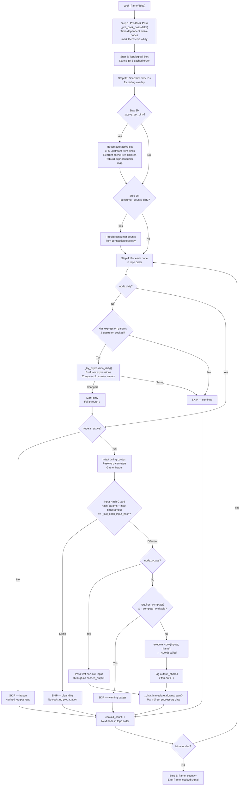

# Cook Engine — Architecture & Walkthrough

> `addons/gonodes/core/gn_cook_engine.gd`

The **GNCookEngine** is a frame-driven graph evaluator. Every `_process()` frame
it walks the node graph in topological order, resolves parameters, and cooks only
the nodes that need updating. This document explains the full cook cycle, lists
every optimisation layer, and walks through concrete examples.

---

## 1. High-Level Pipeline

```
┌──────────────────────────────────────────────────────────────────────────┐
│                         GNCookEngine._process(delta)                    │
│                                                                         │
│  1. Pre-cook pass      – time-dependent active nodes mark_dirty()       │
│  2. Topological sort   – Kahn's BFS (cached, invalidated on topology Δ) │
│  3a. Snapshot dirty IDs – for debug overlay                             │
│  3b. Active set        – BFS upstream from sinks (event-driven)         │
│  3c. Consumer counts   – fan-out per node (event-driven)                │
│  4. Cook loop          – per-node: expr → active → resolve → hash guard │
│                          → bypass/cook → propagate                      │
│  5. Bookkeeping        – frame_count++, frame_cooked signal             │
└──────────────────────────────────────────────────────────────────────────┘
```

---

## 2. Cook Frame Flowchart



---

## 3. Key Concepts

### 3.1 Dirty Flag

Every `GNNode` has a `dirty: bool`. A node is dirty when:

- Its parameter value changed (user edit, expression result change, bind)
- An upstream connection was added/removed
- `_pre_cook()` set it (time-dependent nodes)
- `_dirty_immediate_downstream()` propagated from a cooked upstream

A dirty node is **candidate** for cooking. The input hash guard may still skip it.

### 3.2 Active Set

Not every node in a network cooks every frame. The **active set** is the subset
of nodes that feed into a live "sink" — a viewer, WindowOUT, SpoutOut, etc.

```
   [LFO]──[Noise]──[Ramp]──[Level]──[Viewer ★]
              │
          [Blur]──[CompositeTOP]   ← not connected to sink = INACTIVE
```

Computed via BFS upstream from all sinks. Event-driven: only recomputed when
topology or sinks change (`_active_set_dirty`), not every frame.

Inactive nodes keep their `cached_output` frozen — zero per-frame cost.

### 3.3 Input Hash Guard (Tier 2)

The core Tier 2 optimisation. Before cooking, the engine hashes:

1. **All resolved parameter values** (built-in + spare) via `hash(param.get_resolved_value())`
2. **Upstream input data timestamps** — each `GNData.timestamp` records the frame when the data was last written
3. **Elapsed time** — only for `time_dependent` nodes (ensures they always cook)

```
hash = 73856093
for each param:   hash = hash * 31 + hash(resolved_value)
for each input:   hash = hash * 37 + input.timestamp   (or *37 if null)
if time_dependent: hash = hash * 41 + hash(elapsed_time)
```

If the hash matches `node._last_cook_input_hash` → skip cook, clear dirty, **no downstream propagation**. The cascade stops here.

### 3.4 Expression Consumer Map

Expressions like `chop("lfo1", "out") * 5.0` create **implicit dependencies** not represented by wires. The cook engine:

1. Scans all expression strings with regex for `chop/op/top/sop/dat/mat/vol/img/output("id")` references
2. Builds `_expr_consumer_map`: `upstream_id → [consumer_node_ids]`
3. During the cook loop, a non-dirty node's expressions are only re-evaluated if an upstream source **actually cooked this frame** (`_should_eval_expressions`)

### 3.5 Incremental Dirty Propagation

Unlike a naive upfront BFS that would dirty an entire downstream subtree,
propagation is **incremental and demand-driven**:

```
Node A cooks → _dirty_immediate_downstream(A) → marks B, C dirty
              (only direct successors, not B's children)

When B is reached in topo order:
  Input hash guard checks: did my params + inputs actually change?
  YES → cook B → _dirty_immediate_downstream(B) → marks D, E dirty
  NO  → skip B → D, E stay clean → cascade STOPS
```

This is a key difference from TD, which always cascades the full subtree.

---

## 4. Optimisation Layers

| # | Optimisation | Layer | Effect |
|---|---|---|---|
| 1 | Active-only pre-cook | Tier 1 | `_pre_cook()` skips inactive nodes |
| 2 | Cached topo sort | Tier 1 | Kahn's BFS recomputed only on topology change |
| 3 | Event-driven active set | Tier 1 | BFS from sinks only when topology/sinks change |
| 4 | Scene-tree child reorder | Tier 1 | SubViewports render in dependency order |
| 5 | Expression consumer map | Tier 1 | Skip expression eval if no upstream source cooked |
| 6 | Inactive dirty cutoff | Tier 1 | `propagate_dirty()` stops at inactive boundaries |
| 7 | Input hash guard | Tier 2 | Skip cook when params + input timestamps unchanged |
| 8 | Incremental propagation | Tier 2 | Only direct successors dirtied, cascade stops at hash match |
| 9 | Shared output tagging | — | Fan-out > 1 tags `_shared` for copy-on-write in `_mutable_input()` |
| 10 | Input array caching | — | `_input_cache` reused per node, avoids per-frame allocation |
| 11 | Compute shader guard | — | Skip nodes requiring `RenderingDevice` on Compatibility renderer |

---

## 5. Walk-Through Examples

### Example 1 — Static Network (nothing changes)

```
Network:  [ConstantTOP]──[LevelTOP]──[CompositeTOP]──[Viewer]
```

**Frame N** (steady state, no parameter edits, no time-dependent nodes):

| Step | Node | dirty? | Action |
|---|---|---|---|
| Pre-cook | — | all clean | No time-dependent nodes → nothing dirtied |
| Topo[0] | ConstantTOP | ✗ | No expressions → **SKIP** |
| Topo[1] | LevelTOP | ✗ | No expressions → **SKIP** |
| Topo[2] | CompositeTOP | ✗ | No expressions → **SKIP** |
| Topo[3] | Viewer | ✗ | No expressions → **SKIP** |

**Result:** 0 cooks, 0 skipped-by-hash. Entire frame is a fast no-op scan.

---

### Example 2 — User Edits a Parameter

```
Network:  [NoiseTOP]──[BlurTOP]──[LevelTOP]──[Viewer]
                                     ▲
                           User changes "gain" to 1.5
```

**Frame N** (user changed LevelTOP's `gain` parameter):

| Step | Node | dirty? | Action |
|---|---|---|---|
| Pre-cook | — | LevelTOP dirty (param change) | |
| Topo[0] | NoiseTOP | ✗ | **SKIP** |
| Topo[1] | BlurTOP | ✗ | **SKIP** |
| Topo[2] | LevelTOP | ✓ | Resolve params → hash differs (gain changed) → **COOK** → dirty downstream → Viewer marked dirty |
| Topo[3] | Viewer | ✓ | Resolve params → hash differs (input timestamp changed) → **COOK** |

**Result:** 2 cooks (LevelTOP + Viewer). NoiseTOP and BlurTOP untouched.

**Frame N+1** (no further edits):

| Step | Node | dirty? | Action |
|---|---|---|---|
| Topo[0–3] | all | ✗ | All **SKIP** — back to static |

---

### Example 3 — Time-Dependent Node (LFO)

```
Network:  [LfoCHOP]──[NoiseTOP]──[Viewer]
              ▲
         time_dependent = true
         Output: sine value based on elapsed_time
```

**Every frame:**

| Step | Node | dirty? | Action |
|---|---|---|---|
| Pre-cook | LfoCHOP | ✓ | `_pre_cook()` → `mark_dirty()` (time-dependent) |
| Topo[0] | LfoCHOP | ✓ | Hash includes `elapsed_time` → always differs → **COOK** → dirty NoiseTOP |
| Topo[1] | NoiseTOP | ✓ | Input timestamp changed (LFO re-cooked) → hash differs → **COOK** → dirty Viewer |
| Topo[2] | Viewer | ✓ | Input timestamp changed → **COOK** |

**Result:** Full chain cooks every frame. This is correct — the LFO's output changes every frame, so everything downstream must update.

---

### Example 4 — Hash Guard Stops Propagation

```
Network:  [LfoCHOP]──[MathCHOP (floor)]──[NoiseTOP]──[Viewer]
```

The LFO outputs a smooth sine 0→1→0. The MathCHOP floors it to integer (0 or 1).
Between transitions, the floored value stays the same for many frames.

**Frame where floor(sine) hasn't changed:**

| Step | Node | dirty? | Action |
|---|---|---|---|
| Pre-cook | LfoCHOP | ✓ | time-dependent |
| Topo[0] | LfoCHOP | ✓ | Hash differs (elapsed_time) → **COOK** → dirty MathCHOP |
| Topo[1] | MathCHOP | ✓ | Resolve → **COOK** (input timestamp changed) → output = floor(0.3) = 0, same as last frame |
| | | | But MathCHOP DID cook (hash was different because input timestamp changed) → **dirty NoiseTOP** |
| Topo[2] | NoiseTOP | ✓ | Resolve → hash: params same, BUT input timestamp changed (MathCHOP re-cooked) → **COOK** |
| Topo[3] | Viewer | ✓ | **COOK** |

> **Note:** The hash guard uses timestamps, not output values. If upstream re-cooked, the timestamp changes, so downstream always re-cooks. This is intentional — it matches TD's "demand-driven" model and avoids the cost and accuracy issues of comparing actual output data.

**Where the hash guard DOES save work:** when the LfoCHOP is NOT time-dependent (e.g., it's a ConstantCHOP) and nothing upstream changes, the entire chain is skipped.

---

### Example 5 — Expression-Driven Parameter

```
Network:  [LfoCHOP "lfo1"]     [NoiseTOP]──[Viewer]
                                    ▲
                           seed = chop("lfo1", "out") * 100
                           (expression referencing lfo1)
```

No wire between LfoCHOP and NoiseTOP — the dependency is expression-only.

| Step | Node | dirty? | Action |
|---|---|---|---|
| Pre-cook | lfo1 | ✓ | time-dependent |
| Topo[0] | lfo1 | ✓ | **COOK** → `_cooked_this_frame["lfo1"] = true` |
| Topo[1] | NoiseTOP | ✗ | Not dirty, but has expressions. `_should_eval_expressions()`: lfo1 ∈ `_cooked_this_frame` → **YES** |
| | | | `_try_expression_dirty()`: eval `chop("lfo1","out") * 100` → new value ≠ old → `mark_dirty()` → falls through |
| | | ✓ | Now dirty + active → resolve → hash differs (param changed) → **COOK** → dirty Viewer |
| Topo[2] | Viewer | ✓ | **COOK** |

The expression consumer map (`lfo1 → [NoiseTOP]`) ensures we only check NoiseTOP's expressions, not every node in the network.

---

### Example 6 — Inactive Sub-Graph

```
Active sinks: [Viewer1]

   [LfoCHOP]──[NoiseTOP]──[Viewer1 ★]
       │
   [RampTOP]──[BlurTOP]──[CompositeTOP]
                              (no sink — all inactive)
```

| Step | Node | Action |
|---|---|---|
| Active set | LfoCHOP, NoiseTOP, Viewer1 | BFS upstream from Viewer1 |
| | RampTOP, BlurTOP, CompositeTOP | **NOT in active set** → `is_active = false` |
| Pre-cook | LfoCHOP | ✓ (time-dependent, active) |
| Pre-cook | RampTOP | **SKIPPED** (inactive — `_pre_cook_pass` skips it) |
| Topo[0] | LfoCHOP | **COOK** |
| Topo[1] | RampTOP | dirty=✗ → **SKIP** (was never dirtied) |
| Topo[2] | NoiseTOP | **COOK** |
| Topo[3] | BlurTOP | dirty=✗ → **SKIP** |
| Topo[4] | CompositeTOP | dirty=✗ → **SKIP** |
| Topo[5] | Viewer1 | **COOK** |

**Result:** RampTOP→BlurTOP→CompositeTOP have zero cost — never dirtied, never checked.

---

### Example 7 — Bypass Mode

```
Network:  [NoiseTOP]──[BlurTOP (bypass=true)]──[LevelTOP]──[Viewer]
```

If BlurTOP is dirty:

| Step | Node | Action |
|---|---|---|
| Topo[1] | BlurTOP | dirty ✓, active ✓, resolve params, hash differs → **BYPASS** |
| | | `cached_output = first non-null input` (NoiseTOP's output) |
| | | `_dirty_immediate_downstream()` → LevelTOP marked dirty |

BlurTOP's `_cook()` is never called. The upstream data passes through unchanged.

---

## 6. Data Flow: Dirty Propagation Timeline

```
Frame N: User changes BlurTOP's "radius" param
──────────────────────────────────────────────────

         Parameter UI
              │
              ▼
         BlurTOP.dirty = true
         (param_changed signal → _active_set_dirty for expr map rebuild)

Frame N cook loop:         ConstantTOP    BlurTOP    LevelTOP    Viewer
                              │             │           │          │
  dirty?                    clean          DIRTY       clean      clean
  action                    skip           cook        ─          ─
  after cook:                              ─────┐
  _dirty_immediate_downstream(blur)              ▼
                                              LevelTOP.dirty = true
  action                                        cook       ─
  after cook:                                   ──────┐
  _dirty_immediate_downstream(level)                   ▼
                                                     Viewer.dirty = true
  action                                               cook
  after cook:                                          (sink, no downstream)

Frame N+1:
  dirty?                    clean          clean       clean      clean
  action                    skip           skip        skip       skip
                            ◄─── 0 cooks, fully quiescent ───►
```

---

## 7. Non-Realtime Mode

When `non_realtime = true`, the engine ignores wall-clock delta and advances by
a fixed `1.0 / non_realtime_fps` each frame. This guarantees:

- **Deterministic output** — heavy patches produce identical results to light ones
- **No dropped frames** — every frame cooks exactly once at the target FPS
- **Frame-perfect recording** — used by FFmpeg export for lossless video capture

```gdscript
if non_realtime:
    current_delta = 1.0 / non_realtime_fps   # e.g., 1/30 = 0.0333s
    elapsed_time += current_delta
else:
    current_delta = delta                     # actual wall-clock delta
    elapsed_time += delta
```

---

## 8. SubNetwork Cook Engines

SubNetworkCOMP nodes host an inner `GNCookEngine` with `cooking_enabled = false`.
The outer engine calls `inner_engine.cook_frame(delta)` explicitly during the
SubNetwork's `_cook()`. This enables:

- Nested topological orders (inner graph sorted independently)
- `parent_engine` reference for `op("../node_id")` expression resolution
- Isolated active sets per sub-network

---

## 9. Roadmap

| Tier | Feature | Status |
|---|---|---|
| 1 | Active-only pre-cook, expression consumer map, inactive cutoff | ✅ Done |
| 2 | Input hash guard, incremental propagation | ✅ Done |
| 3 | Multi-threaded cook (level-based parallelism with WorkerThreadPool) | Planned |
| 4 | User-facing thread regions (annotation-based parallel groups) | Planned |

See `GONODES_CONTEXT.md` for detailed Tier 3/4 implementation plans.
